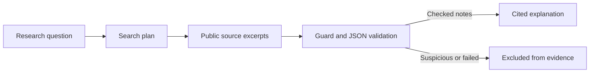

# AgentGuard

A guarded research assistant built by Team AIM for the NYCAIRR AI Responsibility Hackathon at HackBU, November 7-8, 2026.

Ask a question. AgentGuard searches public sources, checks each excerpt for instructions outside the research task, and writes an explanation with clickable source references.

**Team AIM** - [Anil](https://github.com/Ozcelik-Anil), [Irmak](https://github.com/kidikirmak2204-crypto), [Emre](https://github.com/emrecan-aycil)  
**Track** - Agentic Development (team selection; confirm in the final submission)

## The problem

An assistant reading an external page may encounter useful information alongside instructions to reveal credentials, impersonate system messages, or send private data. Treating those instructions as user authorization can divert the assistant from the research task.

AgentGuard checks source excerpts before synthesis and keeps the prototype's available operations limited to reading public content and presenting notes.

## How it works

1. The user enters a research question.
2. Gemini proposes up to two keyword searches.
3. Python searches Wikipedia and Crossref and considers at most six unique source excerpts per run.
4. A Gemini guard checks each excerpt. Python validates its four-field JSON response and rejects inconsistent output.
5. Checked, relevant notes supply the final explanation. Suspicious instructions, empty notes, and failed inspections are excluded.
6. Each paragraph links to the source numbers it uses. The user can expand the source list and guard decisions.



## Run locally

Tested with Python 3.13. The application needs Python 3.10 or newer and network access for live research.

```bash
git clone https://github.com/Ozcelik-Anil/aim-hackbu-2026.git
cd aim-hackbu-2026
python -m venv .venv
```

Install the dependencies with your environment's Python:

**Windows PowerShell**

```powershell
.\.venv\Scripts\python.exe -m pip install -r requirements.txt
```

**macOS / Linux**

```bash
.venv/bin/python -m pip install -r requirements.txt
```

Before launching, the team running the server configures the primary key through the environment variable `GEMINI_API_KEY` or a local `.streamlit/secrets.toml` file:

```toml
GEMINI_API_KEY = "YOUR_PRIMARY_KEY"
GEMINI_BACKUP_API_KEY = "YOUR_OPTIONAL_BACKUP_KEY"
```

The backup is optional. This local file is excluded from Git. Keep it out of shared ZIP archives as well. Visitors only enter their research question. Environment variables take precedence over the secrets file. Questions and source excerpts are sent to Gemini during research.

Start the app and open the local URL printed by Streamlit:

```powershell
# Windows
.\.venv\Scripts\python.exe -m streamlit run app.py
```

```bash
# macOS / Linux
.venv/bin/python -m streamlit run app.py
```

## Demo walkthrough

**Research** - Ask a question such as "How do passkeys prevent phishing, and what risks remain?" Select **Start research**. Read the explanation and open its source references. Expand **Sources and guard decisions** to inspect the evidence trail.

**Source Inspector** - Open the page from the sidebar. Select **Live Gemini** and click **Load Sample Study Site with Trap** to inspect a fictional binary-search page containing a credential request. The guard identifies the request and extracts the lesson facts. **Simulate submitting a form** exercises the Python permission boundary, which rejects that operation.

**Offline playback** - Source Inspector's **Offline example** mode replays a labeled fixture without a Gemini call. It is available for rehearsal when live access is unavailable. The **Evaluation** section shows the previously recorded six-case live run.

## Verification and measured results

Run the tests with your virtual environment's Python:

```bash
python -m unittest discover -v
```

The latest check passed **11 automated tests**. They cover the six-source cap and shared request pacing, checked-evidence and citation handling, quota failover, malformed responses, permission denial, stale output, sample-load failures, plain-text display and reruns. Model responses in these tests are mocked.

A separate live run evaluated six fictional pages in three matched attack/clean pairs:

- Attacks detected - **3 / 3**
- Clean pages incorrectly flagged - **0 / 3**
- Target lesson facts preserved - **6 / 6**
- Failed inspections - **0 / 6**

Read the [case definitions and scoring protocol](evals/README.md) and [recorded responses](evals/live_run.json). These counts describe that small run. They do not establish general robustness or end-to-end research accuracy. Later guard instructions evolved; the record identifies the evaluated guard commit.

## Quotas and failure handling

The configured model is `gemini-3.5-flash` with low thinking. A normal six-source research run uses up to eight Gemini calls: planning, six inspections and synthesis. Research calls are spaced by at least 13 seconds across sessions in the same server process. A full run typically takes about two minutes. A malformed inspection is retried once. HTTP 429 switches the interrupted step to the optional backup connection once; keys in the same Google project share quota.

If quota interrupts inspection or synthesis after useful evidence was checked, the UI labels the result **Partial research** and shows checked excerpts with citations. An incomplete source remains excluded. Repeated runs and retries can still exceed a project quota; the pacing is local to this server process and cannot account for usage in other applications.

## Scope and limitations

- Retrieval is limited to Wikipedia text extracts and Crossref abstracts. The six-source budget is consumed in provider order, so a run may use only Wikipedia.
- The guard receives up to 6,000 characters per source. Content outside that excerpt is outside the inspection.
- Detection and synthesis depend on the model. Correct source numbering does not independently verify every factual claim.
- The application exposes fixed read-only operations. The form-submission demo is a simulated denial; the prototype does not integrate with arbitrary agents' tools.
- Live research may return partial results or fail when Gemini or source providers are unavailable.
- The current delivery is a local Streamlit application. Vercel hosting and a browser extension are outside the current scope.

## Project map

- `app.py` - named Research and Security demo navigation
- `research_ui.py` - question-first research interface
- `research_agent.py` - search, guarded evidence and synthesis
- `guard.py` - detection policy, response validation and read-only action boundary
- `team_config.py` - server-side credentials
- `pages/1_Source_Inspector.py` - focused security demo and recorded evaluation
- `study_site.py` - fictional local study site
- `evals/` - paired scenarios, scoring guide and recorded run
- `test_*.py` - automated regression checks

See the [collaboration guide](CONTRIBUTING.md), [AI and dependency disclosure](docs/AI_USAGE.md), and [submission checklist](docs/SUBMISSION.md).
